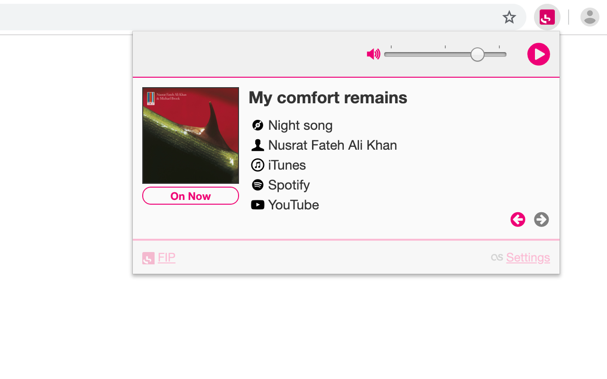
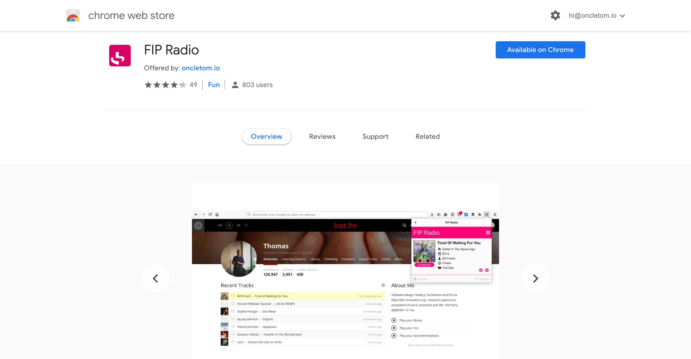
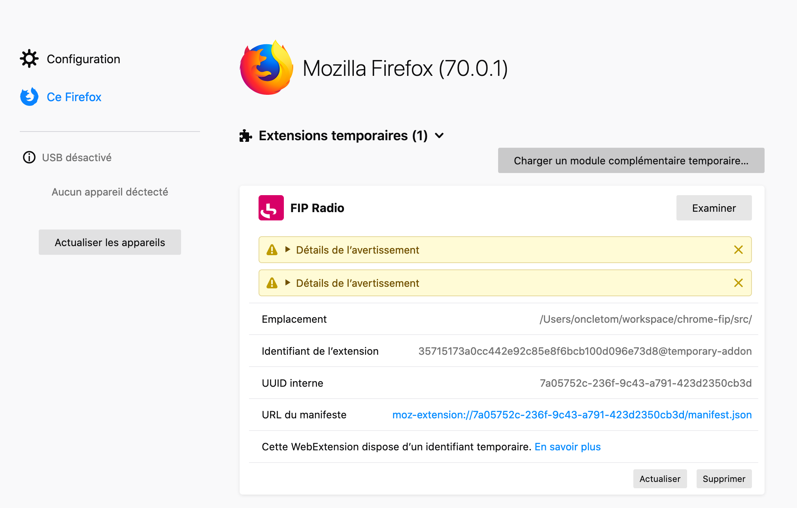
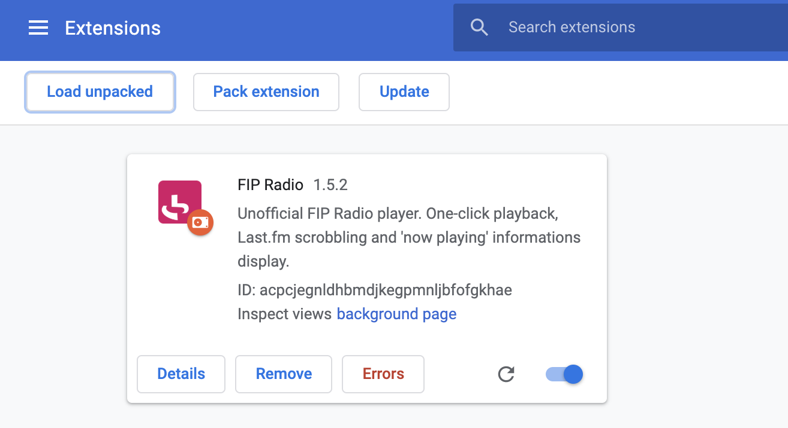
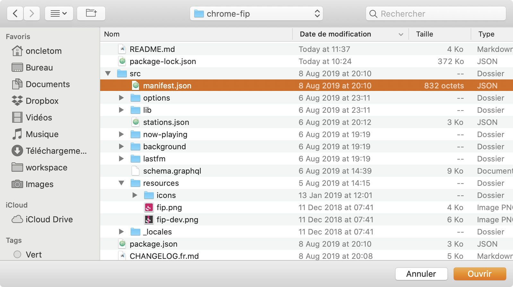

# FIP Radio — for Chrome, Firefox, Edge and Opera web browsers ![][status badge] ![][rating badge] ![][downloads badge] ![][version badge]

> Listen to [FIP Radio](https://www.fip.fr/) in a minimalistic browser interface.
> FIP is an eclectic and ad-free radio station.
> Optionnally scrobble tracks to your last.fm account.

Oh, and it's **ads free** and **trackers free**.<br>
Check the [privacy policy](PRIVACY_POLICY.md) to know more how first-parties (aka. _not me_) may collect data about you.

I developed this extension to listen to my favourite radio station when [I moved from France to London](https://thom4.net/2013/every-day-is-a-brand-new-place/).




# Features

| One-click playback, volume control and song preview | Get to know what aired previously |
| ---              | ---                 |
| ![][img-now]     | ![][img-history]    |


| Select a station | Scrobble to last.fm |
| ---              | ---                 |
| ![][img-stations]| ![][img-lastfm]     |

# Install in your browser




You are **one click away** from installing the extension in your favourite web browser.
_FIP Radio WebExtension_ is distributed on the  official web stores:

* Firefox: [via Firefox Add-ons][Firefox extension]
* Chrome: [via the Chrome Web Store][Chrome extension]
* Opera: [via the Chrome Web Store][Chrome extension]
* Edge: [via the Chrome Web Store][Chrome extension]

Once installed, the radio playback is accessible by clicking on the FIP logo, freshly added to your browser.

That's it!

# Contribute

Contributions are friendly welcomed, either they are code, ideas or bug reports.

The developer toolchain relies on:
- [Angular](http://angularjs.org/) for dynamic HTML templating;
- [Machina.js](https://github.com/ifandelse/machina.js) for State Machine management;
- [WebExtensions API](https://developer.mozilla.org/en-US/docs/Mozilla/Add-ons/WebExtensions), to embed, run and distribute this browser extension.

If you don't know them much… well it's a good occasion to learn!

## Development Setup

You need [Node.js](https://nodejs.org/download/) v26 or later (see [`.nvmrc`](.nvmrc)) to use the development tooling.

Hit the `Clone or download` button above to get a copy of the source code. Then run these commands in a terminal:

```bash
$ npm install
$ npm run watch
```

Then load the **unpacked extension** or **temporary module** in your browser by typing a special URL:

| Firefox           | Chrome
| ---               | ---
| `about:debugging#/runtime/this-firefox`  | `chrome://extensions/`  |
|   |  |

The browser will ask you to **locate the `manifest.json` file**.



After being loaded, any change in the source code will be taken in account immediately ⚠️ **except background page code** — which requires to hit the related `Refresh` or `Reload` button in the extension panel.

[Chrome Dev Tools](https://developers.google.com/chrome-developer-tools/) will
help you debugging by displaying errors or the various state change of the playback.

## Testing

Tests partially assert the code works as expected. You can check on your own:

```bash
$ npm test
```

If you don't think about it, no problem, tests are automated when you contribute back your code.

You will receive help and guidance if adding new tests is necessary.

Current status is pretty poor but the codebase is solid.

## Build from source

This section is meant for add-ons reviewers, to rebuild the published package.

Requirements: [Node.js](https://nodejs.org/download/) v26 or later, npm, and the `zip` command line tool.

```bash
$ npm ci
$ npm run package
```

`npm run build` uses [Rollup](https://rollupjs.org/) to bundle each entry point with its npm dependencies, in [`rollup.config.js`](rollup.config.js). There is no transpilation and no minification: the bundles contain the source code as written.

| Entry point | Bundle |
| --- | --- |
| `src/players/background/index.js` | `src/players/background/bundle.js` |
| `src/now-playing/app.js` | `src/now-playing/bundle.js` |
| `src/options/app.js` | `src/options/bundle.js` |

`npm run package` builds the bundles, then zips them with the other extension files into `dist/webextension-fip-v<version>.zip`. It also archives the committed source code (`git archive HEAD`) into `dist/webextension-fip-v<version>-source.zip`.

The Last.fm API credentials are inlined at build time from the `LAST_FM_KEY` and `LAST_FM_SECRET` environment variables, or from a `.env` file (see [`.env.example`](.env.example)). Without them, the rebuilt bundles only differ from the published ones by these two strings, and Last.fm scrobbling is disabled.

# Privacy Policy

[Read the end user privacy policy](PRIVACY_POLICY.md).

> tl;dr no data is collected.

# License

[MIT license](LICENSE).

[Chrome extension]: 	https://chrome.google.com/webstore/detail/fnhlecpfnocgmmmghkjcipmhdpmpddii
[Firefox extension]: https://addons.mozilla.org/firefox/addon/fip-radio/
[status badge]: https://github.com/thom4parisot/webextension-fip/actions/workflows/release.yml/badge.svg
[downloads badge]: 	https://img.shields.io/chrome-web-store/d/fnhlecpfnocgmmmghkjcipmhdpmpddii.svg
[version badge]: 	https://img.shields.io/chrome-web-store/v/fnhlecpfnocgmmmghkjcipmhdpmpddii.svg
[rating badge]: 	https://img.shields.io/chrome-web-store/rating/fnhlecpfnocgmmmghkjcipmhdpmpddii.svg

[img-now]: resources/screenshots/popup-now-playing.png
[img-history]: resources/screenshots/popup-relative-buffering.png
[img-stations]: resources/screenshots/options-stations.png
[img-lastfm]: resources/screenshots/options-logged-in.png
